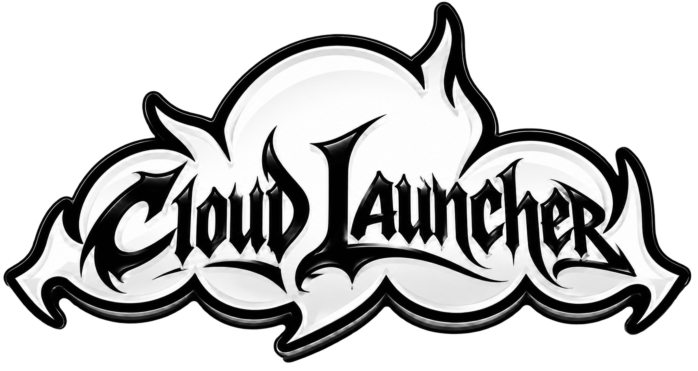

<h1 align="center">Cloud Launcher</h1>

Minecraft, моды и игра с друзьями — в одном лаунчере.

<a href="https://github.com/limplxx/cloud-launcher/releases/latest"><strong>Скачать для Windows</strong></a>

## Установка

1. Откройте страницу [последнего выпуска](https://github.com/limplxx/cloud-launcher/releases/latest).
2. В разделе **Assets** скачайте файл `Cloud-Launcher-Setup-…exe`.
3. Запустите установщик, выберите папку и откройте Cloud Launcher.
4. Войдите через Google, выберите игровой ник и версию Minecraft, затем нажмите «Играть».

Для первой установки и загрузки игры необходимо подключение к интернету. Сервер аккаунтов также должен быть доступен.

## Возможности

- Выбор версий Minecraft Java Edition и загрузчиков Fabric, Forge и OptiFine; доступность зависит от версии игры.
- Установка модов и ресурс-паков вручную и из каталога Modrinth, управление установленными модами.
- Загрузка скина в аккаунт Cloud. Видимость скинов зависит от поддержки системы на стороне других игроков.
- Друзья и приглашения в локальный мир или на сервер, запущенный на компьютере. Для совместной игры нужны совместимые версии и моды.
- Настройки игры, памяти и Java, перенос миров и резервные копии.
- Horizon — отдельная реализация Minecraft на Rust. Её поддержка требует дальнейшей проверки; обычные Java-моды с ней несовместимы.

## Обновления

Установленный лаунчер проверяет новые выпуски на этой странице. Когда обновление загружено, он предложит перезапуск для установки. Версии без встроенного обновления необходимо обновить вручную.

## Важно

Для работы отдельных возможностей могут потребоваться подходящая версия Minecraft, загрузчик, совместимые моды и доступ к серверу Cloud Launcher. Доступность автономного режима и совместимость отдельных сочетаний версий ограничены.

Minecraft — игра Mojang Studios. Cloud Launcher не является официальным продуктом Minecraft и не связан с Mojang Studios или Microsoft.
